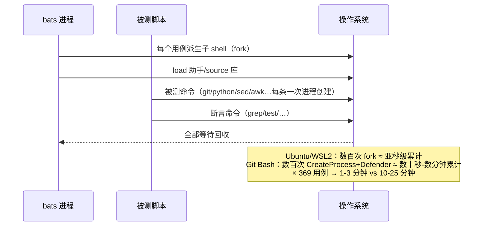

# 测试性能分析与优化指南

三环境（WSL ubuntu 26.04 / GitHub Actions ubuntu 26.04 / Windows git bash）测试耗时差异的深层机理、优化手段分级与基准对比方法。决策背景与 CI 演进备案见 PROJECT_CONTEXT §10。

## 1. 三环境工作原理对比

 bats/测试脚本每次断言、每个被测命令、每条 git/python 调用都是一次进程创建。三个环境的进程创建路径成本相差两个数量级以上：

```mermaid
flowchart TB
    subgraph N["Ubuntu 原生（含 GitHub Actions runner）"]
        A1["bash"] -->|"fork + exec（内核级，写时复制，约 0.1-1ms）"| K1["Linux 内核"] --> P1["子进程就绪"]
    end
    subgraph W["WSL2"]
        A2["bash"] -->|"fork + exec（VM 内真 Linux 内核，约 0.2-1ms）"| K2["轻量 VM 中的 Linux 内核"] --> P2["子进程就绪"]
        P2 -.->|"仅跨 OS 互操作（wsl.exe/clip.exe）与 /mnt/c（9P 协议）才显著变慢"| W2["Windows 宿主"]
    end
    subgraph M["Windows Git Bash（MSYS2 模拟层）"]
        A3["bash（msys-2.0.dll）"] -->|"模拟 fork：无法 COW"| C3["Windows CreateProcess（约 10-50ms）"]
        C3 --> D3["Defender 实时扫描进程映像与文件"]
        D3 --> R3["msys-2.0.dll 运行时初始化"] --> P3["子进程就绪"]
    end
```



要点：

- **原生 Ubuntu**：fork 是内核原语，页表写时复制，无新运行时初始化。
- **WSL2**：bash 与全部 POSIX 工具运行在轻量 VM 的**真 Linux 内核**中，fork/exec 原生速度；只有 `/mnt/c`（9P 网络文件系统协议）与 Windows 互操作调用才慢——仓库在 ext4（`~/` 下）时测试与原生几乎同速。
- **Git Bash**：POSIX 语义由 msys-2.0.dll 在 Windows 上**模拟**。没有可用的 COW fork——每次 fork 都退化为完整 `CreateProcess`（Windows 进程创建要加载 PE 映像、复制句柄、构建令牌），再叠加 msys 运行时初始化；原生 Windows 程序（git.exe/python.exe）则另付 Windows 进程启动成本。

## 2. 一次 bats 运行为什么是 20 分钟 vs 1 分钟



单个用例通常派生 10-50 个进程；369 个用例即数千至上万次进程创建。MSYS 单次创建 10-50ms（不含 Defender），乘出来就是分钟级到十分钟级。

## 3. 慢因分级

| 级别 | 因素 | 说明 |
|---|---|---|
| 主因 | 进程创建成本 | MSYS 模拟 fork + Windows CreateProcess，单个 10-50ms（Linux 的 20-50 倍） |
| 放大器 | Windows Defender 实时扫描 | 每个新进程映像、每个临时文件都扫；实测常见 2-5× 放大 |
| 次要 | NTFS 元数据/ACL 开销 | 文件 stat/open 比 Linux VFS 慢 |
| 次要 | pty/控制台 I/O | MSYS 伪终端转换输出 |

## 4. 优化手段分级

| 层级 | 手段 | 效果与状态 |
|---|---|---|
| 脚本侧（已实现） | 定向运行：`make test-changed` / `run_tests.sh --changed` / 提交门禁 `bats-changed` hook | 典型变更只跑对应 .bats——git bash 从 20 分钟降到秒级-分钟级（回退规则见 test-changed.sh usage） |
| 脚本侧（已实现） | 失败修复循环：`bats test/<分类>/<名>.bats` 或 `make test-one F=<文件>` | 单文件秒级重跑，修完再走全量门禁 |
| 脚本侧（已实现） | timeout 防悬挂 | jsonq 等外部解释器调用不再可能挂死数分钟 |
| 用户侧（推荐，一次性） | Windows 安全中心排除：仓库目录、Git 安装目录、python/scoop 目录 | 消除 Defender 放大器，常见整体 2-5× 提升——**单项最大杠杆** |
| 用户侧（推荐） | 仓库不在 OneDrive/同步工具监控范围内 | 同步扫描同样逐进程放大 |
| 不推荐 | bats 并行（--jobs） | git bash 缺 GNU parallel，装了也受 MSYS fork 上限约束，收益有限 |
| 不推荐 | 为减进程重写测试 | 收益低、可读性损失大；范围问题交给定向运行解决 |
| 未来可选 | WSL/CI 侧 `bats --jobs N`（apt 装 GNU parallel 即可用） | 当前 1-3 分钟无必要；脚本数大幅增长后考虑 |

## 5. 基准对比操作手册（手动验证优化效果）

用 `scripts/dev/bench-tests.sh`（`make bench-tests ARGS="..."`）在同一环境、同一文件集合上做优化前后对比：

```bash
# 1) 优化前存档（git bash 全量约 10-25 分钟）
make bench-tests ARGS="--save /e/proj/bench-before.md"

# 2) 执行优化（如配置 Defender 排除：仓库目录 + Git 安装目录 + python/scoop 目录）

# 3) 优化后重跑
make bench-tests ARGS="--save /e/proj/bench-after.md"

# 4) 对比两份报告的「全跑墙钟」与各文件分时，结论记入 docs/STAGE3_LOG.md
```

注意口径：

- 报告为**双列**：全跑墙钟（一次 `bats 全部文件` 的墙钟）+ 各文件分时（逐文件独立运行）。各文件分时含独立启动开销，**分时总和 > 全跑墙钟属正常**，对比时用同列比同列。
- bench 模式**刻意不加 timeout**——慢正是被测对象，计时工具不得打断慢用例。
- 首轮对比可只跑代表性子集（`ARGS="--files test/text/jsonq.bats --files test/files/dedup.bats"`，分钟级出结果），确认趋势后再全量。
- 结果（优化前后墙钟、排除项配置）记入 `docs/STAGE3_LOG.md`。
